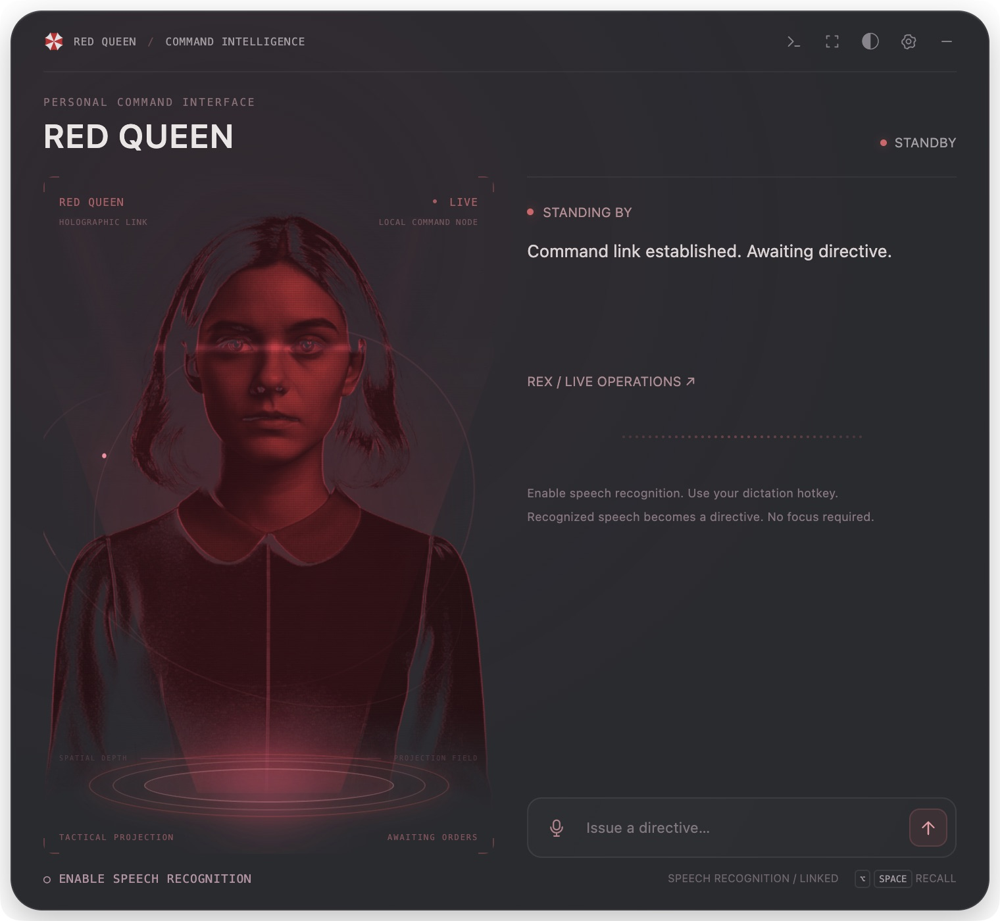

# Red Queen Agent

A personal macOS AI assistant with a cinematic red hologram, a native dynamic island, and observable task execution.



## Features

- **Holographic interface**: five character poses, scanning reveals, parallax, particles, and feedback driven by actual audio levels.
- **Two interface modes**: a full command panel and a native SwiftUI + AppKit dynamic island.
- **Appearance controls**: day and night themes with adjustable background opacity from 30% to 100%.
- **Task execution**: connects to your locally configured Codex CLI or Claude Code, with progress, cancellation, session continuation, and detailed replies.
- **Visible operations**: optional Rex integration displays actual tool calls, command output, and file changes.
- **Speech interaction**: manual input is always available; new dictation transcripts can become directives. Online speech output uses edge-tts, with adjustable speed set to 115% by default.
- **Personal assistant persona**: the assistant calls itself Red Queen. Replies and speech default to Chinese; permanent interface labels are English.

## Requirements and setup

Desktop functionality targets **macOS 14 or later**. Install Node.js and npm. The native island requires an Xcode toolchain with the Swift compiler; speech output requires Python 3 and an internet connection.

```bash
npm ci
npm start
```

Before executing tasks, install and authenticate at least one local execution engine: `codex` or `claude`. This project does not provide model accounts, API keys, or inference credits. Execution engines use your own local configuration. Rex is optional; its absence does not prevent the configured execution engine from working.

The native island builds automatically when first enabled. You can also build it ahead of time:

```bash
npm run build:island
```

Open `native/RedQueenIsland/Package.swift` in Xcode to inspect the native code. The helper requires a connection to the desktop host and does not run as a separate AI instance. If the build fails, the application falls back to a web-based compact window.

Use the top controls to switch interface modes, adjust appearance, configure execution, or hide the window. `Option+Space` shows or hides the interface; `Enter` sends a directive. Active tasks can be stopped. Input-method composition does not trigger automatic submission.

## Speech recognition

The current adapter supports local dictation history from the Bageshuo desktop speech recognition service. The interface calls this capability **Speech Recognition**. Install the service and enable dictation history, then enable speech input in Red Queen and use the service's dictation hotkey.

The adapter extracts only new `dictate` text. It does not read audio directly or use account tokens from the history store. Old records from before startup, a pause, or an account switch are not replayed. Speech input is off by default. Transcripts received during a task are held for manual review and submission.

The adapter lives in `main/dictation.js` and depends on the service's local history format, which may change after an update. Without the service, type or paste directives directly.

## Configuration, privacy, and execution scope

Settings are stored in `~/.javis/config.json`; this directory name is retained for compatibility. Model selection, authentication, and gateway configuration remain in the execution engine's own local settings. Do not commit these settings, account files, personal dictation history, or logs.

The default execution sandbox is `danger-full-access`, which allows the execution engine to run commands with your user permissions. You can select a more restricted mode in settings. Understand the execution scope before issuing directives; persona instructions are not an access-control boundary.

Directives and necessary task context are sent to the configured execution engine or model service. Spoken replies are sent to an online speech service. When Rex is enabled, operations are logged locally in `~/.javis/execution.log`; these logs may contain task content and should not be published.

## Development and validation

```bash
npm test
npm run test:island-runtime
```

`npm test` runs local regression checks without calling a model or online speech service. `test:island-runtime` validates the real Swift helper protocol and shutdown behavior on macOS and requires the local toolchain.

The following optional online smoke tests use your own execution-engine account or an online speech service:

```bash
npm run test:executor
npm run test:tts
```

For a browser visual preview:

```bash
npm run preview
```

Open `http://127.0.0.1:8765/renderer/index.html?preview=1`. The preview lets you switch poses and states without executing tasks or calling models. The native island is available through the desktop application.

## Project structure

- `main/`: Electron host, configuration, execution engines, speech recognition, and Rex integration.
- `renderer/`: full interface, web compact mode, WebGL hologram, and appearance controls.
- `native/RedQueenIsland/`: SwiftUI / AppKit island.
- `prompt/`: response protocol and editable Chinese persona and backstory.
- `assets/poses/`: the five character textures currently used by the interface.
- `test/`: regression checks and optional online smoke tests.

## Current limitations

The character is a 2.5D projection driven by still poses, without continuous skeletal animation or phoneme-accurate lip synchronization. Available operations depend on local tools and permissions; terminal access does not imply the ability to observe or control every application. General screen perception, hands-free wake-word detection, and long-term memory are not included.

Personal debugging records, full-desktop captures, raw generation responses, historical backups, runtime logs, installed dependencies, and an old VRM model without verified provenance are excluded from the public repository.

## Author and license

Author: [lianyichuan](https://github.com/lianyichuan). See [LICENSE](LICENSE) for the copyright notice. Source code is licensed under the MIT License. See [THIRD_PARTY_NOTICES.md](THIRD_PARTY_NOTICES.md) for dependencies, generated visuals, and references to third-party names and marks. Red Queen's Umbrella Corporation origin is a fictional backstory; this project is not an official product of the referenced works or companies.
